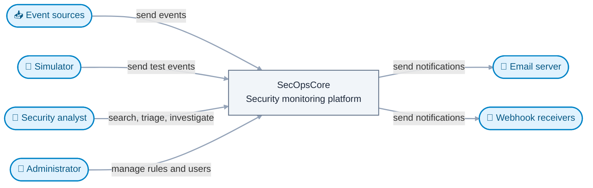
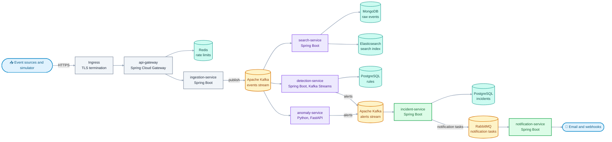
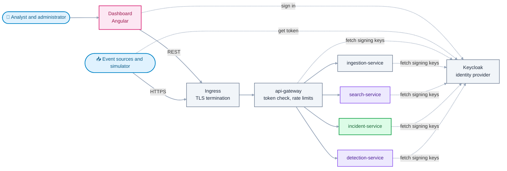
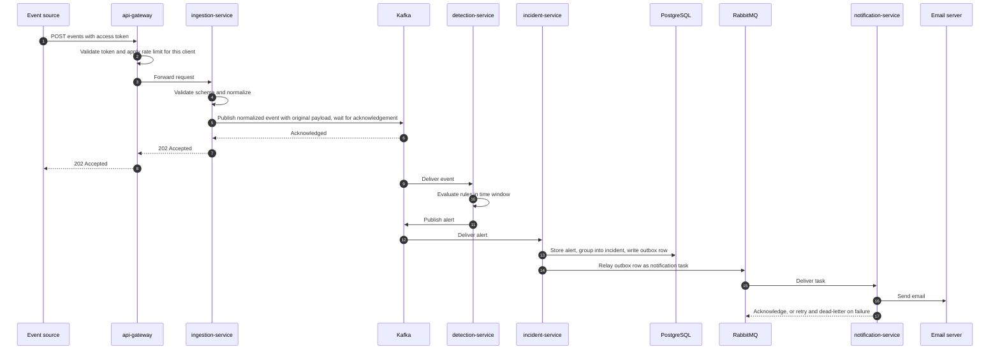
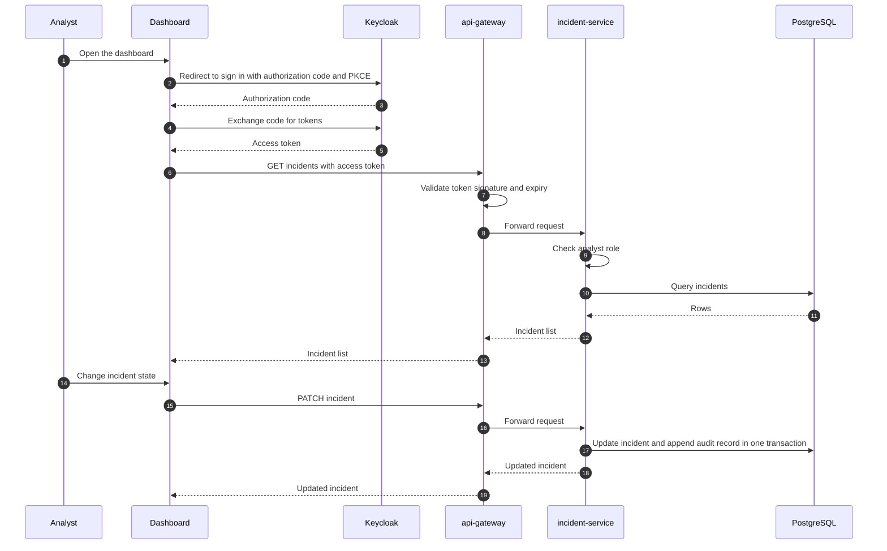
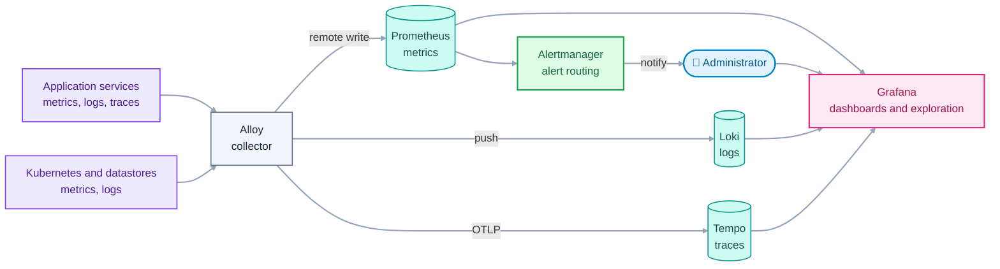
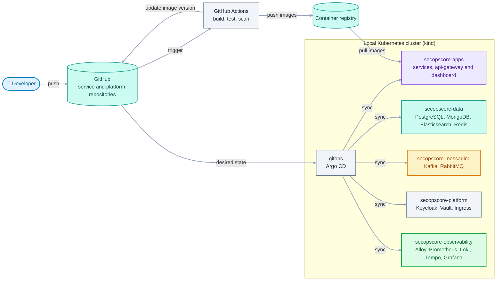

# Architecture

This document describes how SecOpsCore is structured and why. It shows the system
at several levels of detail (following the C4 model), the runtime flows between
services, how data is owned and stored, and the concepts that apply to every
service: security, resilience, observability, caching and deployment.

- **Status:** Accepted
- **Last updated:** 2026-11-13

It is derived from [REQUIREMENTS.md](REQUIREMENTS.md) and uses the terms defined in
[GLOSSARY.md](GLOSSARY.md). Decisions are recorded as Architecture Decision Records
(see [ADR-0001](adr/0001-record-architecture-decisions.md)). Where a decision has no
ADR yet, the text says so, and the ADR is listed in section 11.

## 1. Introduction

### 1.1 Purpose and audience

The document is written for the author (to learn from it and to keep decisions
consistent) and for a reviewer who wants to understand the system in a few minutes.
Detailed contracts, schemas and configuration live in other documents and are only
referenced here.

### 1.2 How to read this document

| If you want to know...                       | Read |
|----------------------------------------------|------|
| What the system is and who uses it           | 3    |
| Which parts exist and how they talk          | 4    |
| What happens to one event, step by step      | 5    |
| Where data lives and who owns it             | 6    |
| How Kafka and RabbitMQ are used              | 7    |
| How security, resilience and monitoring work | 8    |
| How it is deployed                           | 9    |
| How requirements map to the design           | 10   |
| What is still undecided                      | 11   |

### 1.3 Quality goals

These are the qualities that shape the design, in priority order. A security
monitoring platform that loses events or can be abused is worse than a slow one,
so correctness and security rank above speed.

| Priority | Quality                        | What it means here                                                | Requirements             |
|----------|--------------------------------|-------------------------------------------------------------------|--------------------------|
| 1        | Reliability and data integrity | An accepted event is never lost, and duplicates cause no harm.    | NFR-REL-01, NFR-REL-02   |
| 2        | Security                       | The platform resists abuse and protects the data it holds.        | NFR-SEC-01 to NFR-SEC-08 |
| 3        | Independent deployability      | Every service can be built, tested, versioned and deployed alone. | NFR-MNT-01               |
| 4        | Observability                  | Behaviour can be understood from metrics, logs and traces.        | NFR-OBS-01 to NFR-OBS-04 |
| 5        | Scalability and performance    | Throughput grows by adding instances.                             | NFR-SCA-01, NFR-PERF-01  |

### 1.4 Constraints

The constraints in section 6 of [REQUIREMENTS.md](REQUIREMENTS.md) apply: one
developer, local infrastructure, free and open-source tools, independent
repositories. In addition:

- The whole platform must fit on one developer machine, so every component is
  deployed in its smallest sensible form (for example, a single Kafka broker).
- Anything that cannot run locally is out of the design.

## 2. Design principles

| Principle                      | Meaning                                                                   | Consequence                                                                         |
|--------------------------------|---------------------------------------------------------------------------|-------------------------------------------------------------------------------------|
| Independent deployability      | Each service has its own repository, build, image, version and datastore. | Services talk only through contracts. No shared database, no shared business code.  |
| Asynchronous data plane        | Events flow through a message broker. User requests are synchronous REST. | Ingestion is decoupled from processing. The dashboard uses simple request/response. |
| Own your data                  | Every datastore has exactly one owning service.                           | Other services get the data through the owner's API or through events.              |
| Stateless services             | State lives in datastores and in Kafka, not in service memory.            | Any instance can be stopped, replaced or added at any time.                         |
| At-least-once plus idempotency | Messages may be delivered more than once. Processing tolerates it.        | Every consumer is idempotent. Alerts and incidents get deterministic identifiers.   |
| Secure by default              | Deny first, then allow. Least privilege. No secrets in Git.               | Network policies, non-root containers and validation at every boundary.             |
| Observable by default          | Every service exposes health, metrics, structured logs and traces.        | Observability is part of the definition of done for every service.                  |
| Everything as code             | Infrastructure and deployment are declared in Git.                        | The platform repository is the source of truth for what runs.                       |

## 3. System context (C4 level 1)

The context view shows SecOpsCore as one box, with the people and systems around it.

| Party             | Role                                                | Interaction                                           |
|-------------------|-----------------------------------------------------|-------------------------------------------------------|
| Security analyst  | Reviews events and alerts, works on incidents.      | Uses the dashboard. Signs in through OpenID Connect.  |
| Administrator     | Manages users, roles, detection rules and settings. | Uses the dashboard and the identity provider console. |
| Event sources     | External systems that produce security events.      | Push events over HTTPS (and syslog, if implemented).  |
| Simulator         | Produces normal traffic and labelled attacks.       | Behaves like an event source.                         |
| Email server      | Delivers email notifications.                       | Receives mail over SMTP. A local mail sink is used.   |
| Webhook receivers | Systems that react to notifications.                | Receive HTTPS calls.                                  |

## 4. Containers (C4 level 2)

A *container* in C4 is a separately running and deployable unit: a service, a
datastore or a broker. It is not necessarily a Docker container, although here it
usually is.

### 4.1 Event pipeline

This view shows how events travel from sources to notifications and where each
service keeps its data. Colour shows the role of a node, shape shows its kind. The
two Kafka nodes are two streams (topics) of the same Kafka cluster, drawn separately
so that the flow reads from left to right. Requests from sources pass through the
ingress and the api-gateway, described in section 4.2. Cache access is described in
section 8.4.

| Class      | Colour | Used for in this document                                        |
|------------|--------|------------------------------------------------------------------|
| source     | Blue   | External people and systems                                      |
| pipeline   | Gray   | Entry points and platform plumbing (ingress, gateway, ingestion) |
| messaging  | Amber  | Message brokers                                                  |
| storage    | Teal   | Datastores                                                       |
| processing | Violet | Services that analyse, index or serve events                     |
| output     | Green  | Services that turn detections into cases and messages            |
| frontend   | Pink   | The user interface                                               |

### 4.2 Users and identity

This view shows how people and event sources reach the services and how they
authenticate. Dotted lines are calls to the identity provider. Every request passes
through the ingress and the api-gateway, which check tokens and apply rate limits at
the edge. Each service checks the token again and enforces roles itself, so the edge
is never the only check (FR-IAM-03).

### 4.3 Container inventory

| Container            | Kind      | Responsibility                                                                              | Technology                       | Repository             |
|----------------------|-----------|---------------------------------------------------------------------------------------------|----------------------------------|------------------------|
| api-gateway          | Edge      | Single entry point for HTTP traffic: checks tokens, applies rate limits per client, routes. | Java, Spring Cloud Gateway       | `api-gateway`          |
| ingestion-service    | Service   | Validates and normalizes events and publishes them with the original payload.               | Java, Spring Boot                | `ingestion-service`    |
| detection-service    | Service   | Evaluates detection rules over time windows and publishes alerts.                           | Java, Spring Boot, Kafka Streams | `detection-service`    |
| anomaly-service      | Service   | Aggregates behaviour per entity, scores it and publishes alerts.                            | Python, FastAPI, scikit-learn    | `anomaly-service`      |
| search-service       | Service   | Stores raw events, maintains the search index, serves search and the live feed.             | Java, Spring Boot                | `search-service`       |
| incident-service     | Service   | Stores alerts, groups them into incidents, keeps the audit trail.                           | Java, Spring Boot                | `incident-service`     |
| notification-service | Service   | Delivers notifications with retries and a dead-letter path.                                 | Java, Spring Boot                | `notification-service` |
| dashboard            | Web app   | Event search, alert triage, incident handling and rule management.                          | Angular                          | `dashboard`            |
| simulator            | Tool      | Produces normal and labelled attack traffic for demos, tests and training data.             | To be decided                    | `simulator`            |
| Ingress              | Platform  | Terminates TLS and routes external requests into the cluster.                               | Kubernetes Ingress controller    | `platform`             |
| Keycloak             | Platform  | Identity provider for users and event sources.                                              | Keycloak                         | `platform`             |
| Vault                | Platform  | Stores and issues secrets.                                                                  | HashiCorp Vault                  | `platform`             |
| Kafka                | Broker    | Durable event stream for events and alerts.                                                 | Apache Kafka (KRaft)             | `platform`             |
| RabbitMQ             | Broker    | Task queue for notifications with retry and dead-lettering.                                 | RabbitMQ                         | `platform`             |
| PostgreSQL           | Datastore | Relational data: incidents, rules and the identity provider's data.                         | PostgreSQL                       | `platform`             |
| MongoDB              | Datastore | Raw events in their original form. Owned by search-service.                                 | MongoDB                          | `platform`             |
| Elasticsearch        | Datastore | Search index over normalized events. Owned by search-service.                               | Elasticsearch                    | `platform`             |
| Redis                | Datastore | Rate-limit counters and cached aggregations.                                                | Redis                            | `platform`             |

The simulator is a separate repository (ADR-0007). Its language is decided with its
first implementation.

### 4.4 Communication matrix

This table is the quickest way to see which interactions are synchronous and which
are asynchronous, and why.

| From                         | To                                                  | Style                         | Purpose                                                           |
|------------------------------|-----------------------------------------------------|-------------------------------|-------------------------------------------------------------------|
| Event source, simulator      | api-gateway                                         | Synchronous, REST over HTTPS  | Submit events and get an acknowledgement.                         |
| dashboard                    | api-gateway                                         | Synchronous, REST over HTTPS  | Every user request.                                               |
| api-gateway                  | Redis                                               | Synchronous                   | Check and update rate-limit counters per client.                  |
| api-gateway                  | ingestion-service                                   | Synchronous, REST             | Forward event submissions after the token check and rate limit.   |
| api-gateway                  | search-service, incident-service, detection-service | Synchronous, REST             | Forward authenticated user requests.                              |
| ingestion-service            | Kafka                                               | Asynchronous publish          | Publish the normalized event, which carries the original payload. |
| Kafka                        | detection-service                                   | Asynchronous consume          | Evaluate rules.                                                   |
| Kafka                        | anomaly-service                                     | Asynchronous consume          | Score behaviour.                                                  |
| Kafka                        | search-service                                      | Asynchronous consume          | Store raw events and update the index.                            |
| detection-service            | Kafka                                               | Asynchronous publish          | Publish alerts.                                                   |
| anomaly-service              | Kafka                                               | Asynchronous publish          | Publish alerts.                                                   |
| Kafka                        | incident-service                                    | Asynchronous consume          | Store alerts and group them into incidents.                       |
| incident-service             | RabbitMQ                                            | Asynchronous publish (outbox) | Request notifications.                                            |
| RabbitMQ                     | notification-service                                | Asynchronous consume          | Deliver notifications.                                            |
| notification-service         | Email server, webhook receivers                     | Synchronous, SMTP or HTTPS    | Deliver the message.                                              |
| search-service               | dashboard (via api-gateway)                         | Server-sent events            | Live feed of incoming events.                                     |
| dashboard, event sources     | Keycloak                                            | OpenID Connect, OAuth 2.0     | Sign in and obtain tokens.                                        |
| api-gateway and each service | Keycloak                                            | HTTPS                         | Fetch public keys to validate tokens.                             |
| Every service                | Vault                                               | HTTPS                         | Read secrets at start-up.                                         |

The rule behind the table: **events move asynchronously, questions are answered
synchronously.** A user clicking in the dashboard expects an answer now. An event
arriving from a source needs only to be safely accepted and processed soon.

## 5. Runtime flows

### 5.1 From event to notification

This is the main path through the system. It touches the edge, ingestion, the stream,
detection, incidents and notifications.

What guarantees this flow gives:

- **The acknowledgement is the durability point.** The source gets `202 Accepted` only
  after Kafka has confirmed the event. From then on a restart of any service cannot lose
  it (NFR-REL-01).
- **Processing is decoupled from the caller.** If detection or search is slow or down,
  ingestion continues and events wait in Kafka (NFR-REL-03).
- **Alert, incident change and outbox row commit together.** One database transaction in
  `incident-service` means a crash cannot leave a stored alert without its notification
  request (the outbox pattern).
- **Every consumer is idempotent.** Redelivery by Kafka or RabbitMQ is a no-op, because
  deterministic identifiers and unique constraints reject the duplicate (NFR-REL-02).

### 5.2 Analyst sign-in and triage

Key points: the dashboard is a public client, so it uses the *authorization code flow
with PKCE* and never handles passwords. The gateway rejects bad tokens early, but the
service makes the authorization decision: it checks the role on **every** request. The
audit record and the change commit together (FR-INC-05).

### 5.3 Anomaly scoring

1. `anomaly-service` consumes normalized events.
2. It groups them by entity and time window and derives features, for example the number
   of failed logins per minute for an address.
3. It scores each entity-window with the current model version.
4. When a score exceeds the configured threshold it publishes an alert that carries the
   score and the model version (FR-ANO-01 to FR-ANO-03).
5. From there the alert follows the same path as a rule-based alert.

Window state is held in memory. After a restart the service rebuilds recent windows by
replaying events from Kafka. How per-entity ordering is guaranteed across several
instances is an open decision (section 11).

## 6. Data architecture

### 6.1 Ownership

Every datastore has one owner. Nobody else connects to it.

| Datastore             | Owner               | Contents                                                                    | Others access it through |
|-----------------------|---------------------|-----------------------------------------------------------------------------|--------------------------|
| PostgreSQL, rules     | detection-service   | Detection rule definitions, parameters and change history.                  | REST API                 |
| PostgreSQL, incidents | incident-service    | Alerts, incidents, comments, audit trail and the outbox table.              | REST API                 |
| PostgreSQL, identity  | Keycloak            | Users, roles and client registrations.                                      | Keycloak APIs            |
| MongoDB               | search-service      | Raw events in their original form, with source and receive time.            | search-service API       |
| Elasticsearch         | search-service      | Normalized events indexed for search. Can be rebuilt.                       | search-service API       |
| Kafka                 | Producer of a topic | Events, alerts, dead-letter topics and Kafka Streams internal topics.       | Consuming                |
| RabbitMQ              | incident-service    | Notification tasks and their dead-letter queue.                             | Consuming                |
| Redis                 | Shared, namespaced  | Rate-limit counters (gateway) and cached aggregations (search). Disposable. | Owning service's keys    |
| Model files           | anomaly-service     | Versioned anomaly model artifacts.                                          | Loaded at start-up       |

Locally one PostgreSQL instance hosts separate databases, each with its own credentials
and no cross-database access. This keeps the *database per service* principle at a cost
a laptop can bear.

### 6.2 Why these stores

| Need                                  | Store         | Why                                                                         | Trade-off                                                         |
|---------------------------------------|---------------|-----------------------------------------------------------------------------|-------------------------------------------------------------------|
| Incidents, alerts, audit trail, rules | PostgreSQL    | Transactions, constraints and relations. An incident has many alerts.       | Scales vertically. Schema changes need migrations.                |
| Raw events                            | MongoDB       | Payloads differ per source, so a flexible document model fits. TTL indexes. | Weak at joins and full-text analytics.                            |
| Searching events                      | Elasticsearch | Inverted index, full-text search, aggregations and time-range filters.      | Memory-hungry. Eventually consistent. Not a system of record.     |
| Rate limits and cached aggregations   | Redis         | In-memory speed, atomic counters, expiry.                                   | Data is lost on restart, so nothing important may live only here. |
| Moving events between services        | Kafka         | Durable ordered log, replay, many independent consumers.                    | Operationally heavier. Delivery is at-least-once.                 |

The reasons for MongoDB plus Elasticsearch are in ADR-0004, and for Kafka plus RabbitMQ
in ADR-0003.

### 6.3 Consistency

- **Inside one service**, changes are transactional.
- **Between services**, consistency is eventual. Events reach the search index and the
  incident store a short time after they were accepted.
- **Between a database and a broker**, `incident-service` uses the outbox pattern to
  prevent divergence.
- **Elasticsearch is derived data.** If it is lost or its mapping changes, it is rebuilt
  from MongoDB or by replaying the stream.

### 6.4 Retention

The values are initial targets and are tuned after load tests.

| Data                  | Retention                                                  | Mechanism                                    |
|-----------------------|------------------------------------------------------------|----------------------------------------------|
| Kafka events          | 7 days. Must exceed the longest tolerated consumer outage. | Topic retention                              |
| Raw events in MongoDB | 30 days, configurable (FR-STO-02).                         | TTL index                                    |
| Search index          | Same as MongoDB.                                           | Time-based indices removed by lifecycle rule |
| Incidents and alerts  | Kept until deleted by an administrator.                    | None                                         |
| Audit trail           | Kept as long as the incident it belongs to.                | None                                         |

## 7. Messaging architecture

### 7.1 Two brokers, two jobs

| Aspect            | Kafka                                            | RabbitMQ                                     |
|-------------------|--------------------------------------------------|----------------------------------------------|
| Model             | Append-only log, consumers track their position. | Queues, the broker tracks each message.      |
| Best for          | High-volume ordered data, replay, many readers.  | Tasks, per-message acknowledgement, retries. |
| After consumption | Messages stay until retention expires.           | Messages are removed after acknowledgement.  |
| Several consumers | Each consumer group reads everything.            | Competing consumers share the work.          |
| Used here for     | Normalized events and alerts.                    | Notification tasks.                          |

Using both is a deliberate showcase of choosing the tool for the job. Events are data
that several services need and that must be replayable. A notification is a task that
exactly one worker must complete, with retries and a place for failures (ADR-0003).

### 7.2 Design decisions

1. **Acknowledge after a durable write.** Ingestion waits for the Kafka acknowledgement
   from all in-sync replicas before answering the source. Locally a single broker means
   one replica, which is a known limitation (section 8.2).
2. **The event carries what consumers need.** The normalized event carries the original
   payload unchanged inside it. One message means one atomic publish, and no consumer has
   to call back to ingestion. `search-service` stores the original payload in MongoDB from
   the event (ADR-0008).
3. **Keys and ordering.** Order matters per entity (NFR-SCA-02), so events are keyed so
   that those of one entity land in the same partition. Different rules group by
   different entities, so `detection-service` re-keys the stream where needed, which
   Kafka Streams does natively. The initial partition count is 6, adjusted after load
   tests.
4. **Delivery semantics.** Delivery is at-least-once everywhere. Kafka Streams runs with
   exactly-once processing for its internal state. End-to-end correctness comes from
   idempotent consumers, not from the broker.
5. **Failure handling.** A message that cannot be processed is retried with backoff, then
   moved to a dead-letter topic or queue so that it does not block its partition.
   Dead-letter contents are monitored and have a runbook.
6. **Schemas and compatibility.** Event schemas live in the `contracts` repository and are
   checked for backward compatibility. A breaking change gets a new topic version. The
   format and the registry product are decided with the event catalog.
7. **Outbox.** `incident-service` writes the notification request to a table in the same
   transaction as the incident change, and a relay publishes it to RabbitMQ. The relay is
   a polling publisher first. Change data capture is a possible later upgrade.

## 8. Cross-cutting concepts

### 8.1 Security

Details live in the security documents (planned). This is the structure.

**Trust zones**

| Zone          | Contains                                   | Exposure                                                                                         |
|---------------|--------------------------------------------|--------------------------------------------------------------------------------------------------|
| External      | Sources, simulator, browsers.              | Untrusted. Reaches the system only through the ingress.                                          |
| Edge          | Ingress and api-gateway.                   | The only components reachable from outside the cluster. Tokens and rate limits are checked here. |
| Application   | Services and the dashboard's static files. | Reachable from the gateway and from other services. Each checks tokens and roles.                |
| Data          | Databases and brokers.                     | Reachable only from their owning services.                                                       |
| Platform      | Keycloak, Vault, Argo CD.                  | Keycloak is reachable from the edge. Others are internal.                                        |
| Observability | Alloy, Prometheus, Loki, Tempo, Grafana.   | Collects from every zone. Grafana is for administrators.                                         |

**Authentication**

| Actor                  | Mechanism                                                                           |
|------------------------|-------------------------------------------------------------------------------------|
| Analyst, administrator | OpenID Connect, authorization code flow with PKCE, against Keycloak.                |
| Event source           | OAuth 2.0 client credentials. Each source is a registered client (FR-ING-04).       |
| Service to service     | Mutual TLS, if adopted (NFR-SEC-05, open decision). Access tokens for user context. |
| Syslog source          | Decided when FR-ING-02 is designed. Mutual TLS is the likely approach.              |

**Authorization.** Keycloak issues the roles `analyst` and `administrator` in the token.
**Each service enforces them itself**, with method-level checks, instead of trusting the
gateway or the dashboard (FR-IAM-03). The gateway's token check rejects bad requests
early, but it is not the authorization decision. Hiding a button in the UI is not access
control.

**Rate limiting.** The gateway limits requests per client, using the client identity in
the token. Each event source is its own client, so this is also the per-source limit
(FR-ING-06). Keeping every limit in one place avoids two sets of rules that must agree.

**Transport.** TLS terminates at the ingress with certificates from a local certificate
authority. Traffic inside the cluster is encrypted where service-to-service mTLS is
adopted.

**Secrets.** Secrets are held in Vault and delivered to workloads at runtime. They are
never in Git and never in images (NFR-SEC-02).

**Hardening.** Containers run as non-root with a read-only root filesystem and no extra
capabilities. Network policies deny all traffic by default, and each allowed path is
declared (NFR-SEC-04).

**Supply chain.** The pipeline scans code, dependencies and images, generates an SBOM and
fails on high-severity findings (NFR-SEC-06).

**Audit.** Incident changes are written to an append-only table. The application's
database role may insert and read it but not update or delete (NFR-SEC-07).

**Masking and evidence.** Original payloads are kept unchanged as evidence (FR-STO-01).
Sensitive fields (NFR-SEC-08) are masked in the normalized fields used for search and
display. Because the event carries the original, unmasked payloads also sit in Kafka for
its 7-day retention. Kafka is in the data zone and each topic is readable only by the
services that consume it.

### 8.2 Resilience

| Failure                                          | Effect                                                       | Mitigation                                                                                                                 |
|--------------------------------------------------|--------------------------------------------------------------|----------------------------------------------------------------------------------------------------------------------------|
| An ingestion instance restarts                   | In-flight requests fail and sources retry.                   | The `202` comes only after Kafka confirms the write, so no accepted event is lost.                                         |
| Kafka is unavailable                             | Ingestion answers `503`. Sources retry.                      | Accepted data is safe. Kafka is the one critical dependency, and a single local broker is a known single point of failure. |
| api-gateway is down                              | No external access. Internal traffic is unaffected.          | Two replicas in Kubernetes. The gateway holds no state.                                                                    |
| detection-service is down                        | Alerts are delayed.                                          | Events wait in Kafka. The backlog is processed on recovery. Ingestion is unaffected.                                       |
| incident-service or its database is down         | Incident views fail. Alerts wait.                            | Alerts stay in Kafka. The consumer retries with backoff.                                                                   |
| search-service, MongoDB or Elasticsearch is down | Search and live feed are unavailable.                        | Events stay in Kafka, whose retention exceeds the expected outage. Ingestion is unaffected.                                |
| RabbitMQ or notification-service is down         | Notifications are delayed.                                   | Outbox rows stay in PostgreSQL until the relay succeeds.                                                                   |
| An email or webhook target fails                 | One notification fails.                                      | Retries with backoff, then a parking queue for review (FR-NOT-02).                                                         |
| Redis is down                                    | Shared rate-limit counters and cached aggregations are lost. | The gateway falls back to per-instance limits. Aggregations are recomputed.                                                |
| Keycloak is down                                 | No new sign-ins or source tokens.                            | The gateway and services keep validating tokens with cached keys until the tokens expire.                                  |
| A message is delivered twice                     | Risk of a duplicate alert or incident.                       | Idempotent consumers, deterministic identifiers and unique constraints (NFR-REL-02).                                       |
| A message cannot be processed                    | Risk of blocking a partition.                                | Retry, then dead-letter topic.                                                                                             |

Calls between services use timeouts, retries with backoff and circuit breakers
(NFR-REL-04), so a slow dependency cannot exhaust a caller's threads.

### 8.3 Observability

Every workload produces three kinds of signal, collected by one agent (ADR-0005).

| Signal  | Produced by                                             | Collected by               | Stored in  | Used for                            |
|---------|---------------------------------------------------------|----------------------------|------------|-------------------------------------|
| Metrics | Micrometer in Java services, a client library in Python | Alloy scrapes each service | Prometheus | Dashboards, SLOs and alerts         |
| Logs    | Structured JSON on standard output                      | Alloy reads container logs | Loki       | Debugging and audit of the platform |
| Traces  | OpenTelemetry instrumentation                           | Alloy receives OTLP        | Tempo      | Following one request or event      |

Three practices tie the signals together:

- **Trace context travels with messages.** The W3C trace context is passed in HTTP headers
  and in Kafka and RabbitMQ message headers, so one trace can follow an event from the
  gateway to notification (NFR-OBS-03).
- **Every log line carries the trace identifier**, so a log search jumps to the trace and
  back (NFR-OBS-02).
- **Every service exposes liveness, readiness and metrics endpoints** that Kubernetes and
  Prometheus use (NFR-OBS-01).

Service level objectives and alert rules are defined in `SLOs.md` (planned).

### 8.4 Caching

Redis holds rate-limit counters and one cache, both with an expiry.

| Use                 | Owner          | How it works                                                                            | If Redis is lost               |
|---------------------|----------------|-----------------------------------------------------------------------------------------|--------------------------------|
| Rate-limit counters | api-gateway    | One token bucket per client, so per event source (FR-ING-06).                           | Per-instance in-memory limits. |
| Aggregation results | search-service | Dashboard summaries are cached for a short time and recomputed on a miss (cache-aside). | Recomputed from Elasticsearch. |

Redis never holds the only copy of anything. Keys are namespaced per service.

### 8.5 Configuration

Configuration is externalized and differs per environment, never baked into images.
Non-secret settings come from Kubernetes configuration. Secrets come from Vault.
Detection rule parameters are data, not configuration, and are changed at runtime through
the API (FR-DET-04).

### 8.6 Interfaces and contracts

REST APIs are described with OpenAPI. Events are described with versioned schemas. Both
live in the `contracts` repository. Consumers are checked against providers with contract
tests, which is what lets services deploy independently (NFR-MNT-05). The simulator
consumes the same contracts as any other source. Conventions are in `API_GUIDELINES.md`
(planned).

## 9. Deployment view

The whole platform runs on a local Kubernetes cluster created with kind. State is
declared in Git, and Argo CD applies it.

- **One namespace per concern** makes network policies and access rules simple to state:
  for example, only `secopscore-apps` may talk to `secopscore-data`.
- **Helm charts** package each component. They live in the `platform` repository, together
  with the Argo CD application definitions.
- **GitOps.** Nobody runs `kubectl apply` by hand. A change is a commit, and Argo CD
  reconciles the cluster to match.
- **A reduced setup with Docker Compose** runs only the services under development and
  their direct dependencies, for fast daily work (NFR-OPS-02).
- **The simulator** runs as a Compose service or a Kubernetes Job, never as a permanent
  workload.

Details are in `DEPLOYMENT.md` and `DEVELOPMENT.md` (planned).

## 10. Requirements coverage

| Requirements               | How the architecture satisfies them                                                                                                               | Section     |
|----------------------------|---------------------------------------------------------------------------------------------------------------------------------------------------|-------------|
| FR-ING-01 to FR-ING-07     | `ingestion-service` validates and normalizes, then publishes. The gateway rate-limits each source.                                                | 4, 5.1, 8.1 |
| FR-STO-01 to FR-STO-05     | `search-service` owns MongoDB for raw events and Elasticsearch for search.                                                                        | 6           |
| FR-DET-01 to FR-DET-06     | `detection-service` runs rules as Kafka Streams windows. Rules are data in PostgreSQL.                                                            | 4, 7.2      |
| FR-ANO-01 to FR-ANO-04     | `anomaly-service` scores entity windows with versioned models.                                                                                    | 5.3         |
| FR-INC-01 to FR-INC-06     | `incident-service` stores alerts, groups incidents and appends to the audit trail.                                                                | 5.1, 5.2    |
| FR-NOT-01 to FR-NOT-03     | Outbox to RabbitMQ, then `notification-service` with retries and a parking queue.                                                                 | 5.1, 7      |
| FR-DSH-01 to FR-DSH-06     | Angular dashboard calling services through the gateway, with a live feed over SSE.                                                                | 4           |
| FR-IAM-01 to FR-IAM-04     | Keycloak for identity. The gateway and every service validate tokens, and services enforce roles.                                                 | 4.2, 8.1    |
| FR-SIM-01 to FR-SIM-03     | The simulator, in its own repository, acts as an event source and consumes the same contracts.                                                    | 3, 4.3      |
| NFR-PERF-01 to NFR-PERF-03 | Partitioned topics, batched writes, a search-optimized index and cached aggregations.                                                             | 6, 7.2      |
| NFR-REL-01 to NFR-REL-04   | Durable write before acknowledgement, idempotent consumers, outbox, circuit breakers.                                                             | 5.1, 8.2    |
| NFR-SCA-01, NFR-SCA-02     | Stateless services, consumer groups and keyed partitions.                                                                                         | 2, 7.2      |
| NFR-SEC-01 to NFR-SEC-08   | TLS, token checks and rate limits at the gateway, Vault, hardening, network policies, scanning, an append-only audit trail and masking.           | 8.1         |
| NFR-OBS-01 to NFR-OBS-04   | Alloy with Prometheus, Loki and Tempo, trace context in messages, SLOs.                                                                           | 8.3         |
| NFR-MNT-01 to NFR-MNT-05   | One repository per service, contracts repository, ADRs and conventions.                                                                           | 2, 8.6      |
| NFR-OPS-01 to NFR-OPS-04   | kind, Docker Compose, GitOps and runbooks.                                                                                                        | 9           |
| NFR-USA-01                 | Accessibility is a dashboard design concern (keyboard navigation, contrast, semantic markup) and is covered in the dashboard's own documentation. | 4           |

## 11. Open decisions, risks and planned ADRs

### 11.1 Open decisions

These need an answer before the affected service is designed.

| Decision                                       | Current proposal                                                | Decided in                        |
|------------------------------------------------|-----------------------------------------------------------------|-----------------------------------|
| Event schema format and registry product       | Avro or Protobuf, to be compared.                               | `EVENT_CATALOG.md` and ADR        |
| Per-entity ordering for `anomaly-service`      | Re-keyed topic, mechanism to be designed.                       | `anomaly-service` design          |
| How rule changes reach `detection-service`     | Reload on change, mechanism to be designed.                     | `detection-service` design        |
| Where model files are stored                   | Versioned files on a volume, object storage if needed.          | `ml/` and ADR                     |
| Service-to-service mTLS mechanism              | Service mesh or application-level certificates, to be compared. | ADR                               |
| Syslog authentication                          | Mutual TLS.                                                     | `ingestion-service` design        |
| Language of the simulator                      | Decided with its first implementation.                          | `simulator` repository            |
| Whether `search-service` is later split in two | Keep one service until it grows.                                | Review after the walking skeleton |

Decided during the first sprint: the gateway is kept, with every rate limit in it
(ADR-0006); the simulator has its own repository (ADR-0007); and the original payload
travels inside the normalized event (ADR-0008).

### 11.2 Risks

| Risk                                        | Impact                             | Mitigation                                                              |
|---------------------------------------------|------------------------------------|-------------------------------------------------------------------------|
| The platform is too heavy for one machine   | Slow or unstable local environment | Smallest deployments, memory limits, the reduced Compose setup.         |
| Too many technologies to finish             | A half-built system                | Walking skeleton first, features in vertical slices, MoSCoW priorities. |
| Coordination cost of many repositories      | Slow changes that span services    | Contracts first, one change per repository, automated checks.           |
| Unmasked payloads also sit in Kafka         | Sensitive data in one more place   | Data zone only, per-topic access, 7-day retention.                      |
| Single Kafka broker                         | No fault tolerance locally         | Accept and document it. Test recovery by restarting the broker.         |
| Kafka Streams state is hard to reason about | Subtle detection bugs              | Small rules first, tests with a topology test driver, replay tests.     |

### 11.3 Planned ADRs

Decisions 0001 to 0008 are recorded. These are still to be written, with their
alternatives, when their area is designed.

| Decision to record                  | Main requirements    |
|-------------------------------------|----------------------|
| Use Keycloak as identity provider   | FR-IAM-01, FR-IAM-04 |
| Use Vault for secrets               | NFR-SEC-02           |
| Use Helm and Argo CD for deployment | NFR-OPS-03           |
| Give every service its own database | NFR-MNT-01           |

## 12. Concepts introduced here

Each concept below deserves a short note in `learning/` (planned). They are the ideas an
interviewer is most likely to probe.

| Concept                                    | Where it appears | Question it answers                                               |
|--------------------------------------------|------------------|-------------------------------------------------------------------|
| C4 model                                   | 3, 4             | How do I describe a system at the right level of detail?          |
| Database per service                       | 2, 6             | Why can't two services share a database?                          |
| Outbox pattern                             | 5.1, 7.2         | How do I update a database and send a message reliably?           |
| Event-carried state transfer               | 7.2              | Why does an event carry the data its consumers need?              |
| Claim check pattern                        | ADR-0008         | When is passing a reference better than passing the data?         |
| Idempotent consumer                        | 5.1, 8.2         | What happens when a message is delivered twice?                   |
| Kafka partitions, keys and consumer groups | 7.2              | How do I scale consumers and keep ordering?                       |
| Kafka versus a message queue               | 7.1              | When do I pick a log, and when a queue?                           |
| Authorization code flow with PKCE          | 5.2, 8.1         | How does a browser app sign in without a client secret?           |
| API gateway and defence in depth           | 4.2, 8.1         | What does a gateway add if every service checks the token anyway? |
| Rate limiting with a token bucket          | 8.1, 8.4         | How do I cap a client's request rate fairly?                      |
| Circuit breaker and backoff                | 8.2              | How do I stop one failure from spreading?                         |
| Cache-aside                                | 8.4              | How do I use a cache without making it a source of truth?         |
| Trace context propagation                  | 8.3              | How do I follow one request across services and brokers?          |
| GitOps                                     | 9                | Why is a commit the only way to change the cluster?               |
