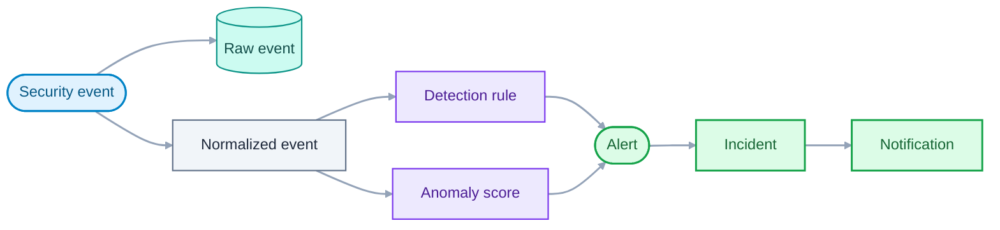

# Glossary

This glossary defines the terms used across SecOpsCore documentation, code and
discussions. Every document uses these terms with the meanings given here. When a
term is used differently somewhere, either that usage or this entry is wrong, and
the mismatch is fixed.

- **Status:** Draft
- **Last updated:** 2026-11-13

## How to use this glossary

- Entries are grouped by theme and sorted alphabetically within each group.
- Terms that are easy to confuse are compared in a separate table at the end of
  the domain section.
- A new term is added in the same change that first uses it in another document.
- Names of services, topics and fields are not defined here. They live in
  `ARCHITECTURE.md`, `EVENT_CATALOG.md` and `DATA_MODEL.md`.

## 1. Core domain

### How the main terms relate

### Terms

| Term             | Definition                                                                                                                                                                                                                               |
| ---------------- | ---------------------------------------------------------------------------------------------------------------------------------------------------------------------------------------------------------------------------------------- |
| Alert            | A record created when a detection rule or the anomaly model flags suspicious activity. It has a severity and references the events that triggered it. An alert is a signal, not yet a case: related alerts are grouped into an incident. |
| Anomaly          | Behaviour that deviates significantly from what is normal for an entity, whether or not it matches a known attack pattern.                                                                                                               |
| Anomaly score    | A number the anomaly model assigns to an entity's behaviour in a time window. A higher score means more unusual behaviour. It is compared with a threshold to decide whether to raise an alert.                                          |
| Audit trail      | An append-only record of who changed what and when, for example every change to an incident. It is never edited or deleted through the application.                                                                                      |
| Baseline         | The normal behaviour of an entity or of a population of entities. Anomalies are deviations from a baseline.                                                                                                                              |
| Detection rule   | A condition evaluated continuously against the event stream that raises an alert when it matches. Example: more than five failed logins from one address within five minutes.                                                            |
| Entity           | The subject whose behaviour is analysed: a user account or a source address.                                                                                                                                                             |
| Event schema     | The formal definition of the fields, types and constraints an event must satisfy to be accepted.                                                                                                                                         |
| Event source     | An external system that sends security events to the platform. Each source has its own credential.                                                                                                                                       |
| False negative   | A real threat that the platform fails to detect.                                                                                                                                                                                         |
| False positive   | An alert or incident for activity that is not a real threat. Also a final state of an incident.                                                                                                                                          |
| Feature          | A numeric value derived from events and used as model input, for example the number of failed logins per entity per minute.                                                                                                              |
| Incident         | A case that groups related alerts for an analyst to investigate. It has a lifecycle, a severity, an optional assignee, comments and an audit trail.                                                                                      |
| Model version    | The identifier of a trained anomaly model. Each anomaly score records the version that produced it.                                                                                                                                      |
| Normalized event | A raw event converted into the common event format used by all downstream services.                                                                                                                                                      |
| Notification     | A message sent to a person or system when an incident reaches a configured severity.                                                                                                                                                     |
| Raw event        | An event exactly as it was received, stored without modification.                                                                                                                                                                        |
| Security analyst | A user who reviews events and alerts, investigates and resolves incidents.                                                                                                                                                               |
| Administrator    | A user who manages users, roles, detection rules and system settings.                                                                                                                                                                    |
| Security event   | A record of something that happened on a monitored system, such as a login attempt, a network connection or a file access. It is the basic input of the platform.                                                                        |
| Severity         | An ordered rating of how serious an alert or incident is. The levels (low, medium, high, critical) are finalized in the event and alert schemas.                                                                                         |
| Simulator        | A tool that generates normal event traffic and labelled attack scenarios for demos, tests and model training.                                                                                                                            |
| Threshold        | A configured value above which a count or score raises an alert.                                                                                                                                                                         |
| Time window      | A fixed duration over which events are counted or correlated. A tumbling window does not overlap with the next one. A sliding window moves forward continuously.                                                                         |
| Triage           | The first review of an alert to decide whether it is real, how serious it is and what to do next.                                                                                                                                        |
| True positive    | A real threat that is correctly detected.                                                                                                                                                                                                |

### Incident lifecycle

| State          | Meaning                                                        |
| -------------- | -------------------------------------------------------------- |
| Open           | The incident was created and no one has started working on it. |
| Investigating  | An analyst is working on it.                                   |
| Resolved       | The threat was confirmed and handled.                          |
| False positive | The activity was investigated and is not a threat.             |

### Attack patterns used by built-in rules

| Term              | Definition                                                                                          |
| ----------------- | --------------------------------------------------------------------------------------------------- |
| Brute force       | Many authentication attempts against an account or service in a short time, to guess credentials.   |
| Impossible travel | Two logins by the same account from locations too far apart to be reached in the time between them. |
| Port scan         | An attempt to find open network ports on a target by probing many of them in sequence.              |

### Commonly confused terms

| Pair                              | Difference                                                                                                                                                                                                                          |
| --------------------------------- | ----------------------------------------------------------------------------------------------------------------------------------------------------------------------------------------------------------------------------------- |
| Event and alert                   | An event records that something happened. An alert says that something suspicious was detected. Most events never produce an alert.                                                                                                 |
| Alert and incident                | An alert is one signal. An incident is a case that groups related alerts and is worked on by a person.                                                                                                                              |
| Detection rule and anomaly model  | A rule matches a known pattern that a person defined. A model scores how unusual behaviour is, without a fixed pattern.                                                                                                             |
| Log and security event            | A log line is diagnostic output from a program, including the platform's own services. A security event is a record of security-relevant activity sent to the platform for analysis. SecOpsCore's own logs are not security events. |
| Raw event and normalized event    | The raw event is kept unchanged for evidence. The normalized event is the common-format copy used for processing.                                                                                                                   |
| False positive and false negative | A false positive is a wrong alarm. A false negative is a missed threat. Reducing one usually increases the other.                                                                                                                   |

## 2. Messaging and architecture

| Term                | Definition                                                                                                                                                         |
| ------------------- | ------------------------------------------------------------------------------------------------------------------------------------------------------------------ |
| Backoff             | Waiting longer between each retry of a failed operation, often with a random component, so that retries do not overload a recovering service.                      |
| Circuit breaker     | A pattern that stops calling a failing dependency for a while and fails fast instead, then tests whether the dependency has recovered.                             |
| Consumer            | A program that reads messages from a topic or queue.                                                                                                               |
| Consumer group      | A set of consumers that share the partitions of a topic, so that each message is processed by one member of the group.                                             |
| Contract            | The agreed interface between services: an API specification or an event schema. Contracts are versioned and live in the `contracts` repository.                    |
| Dead-letter queue   | A queue or topic that receives messages that could not be processed after the allowed retries, so that they can be inspected without blocking the rest.            |
| Event stream        | The ordered, durable flow of events between services, from which any number of consumers can read independently.                                                   |
| Idempotent consumer | A consumer that produces the same result if it receives the same message more than once. It is required because delivery can be duplicated.                        |
| Message broker      | Software that receives messages from producers and delivers them to consumers.                                                                                     |
| Outbox pattern      | Writing a message to a database table in the same transaction as the data change, and publishing it afterwards, so that the change and the message cannot diverge. |
| Partition           | A subdivision of a topic. Messages with the same key go to the same partition, which preserves their order. Partitions allow parallel processing.                  |
| Producer            | A program that writes messages to a topic or queue.                                                                                                                |
| Schema registry     | A service that stores event schemas and checks that new versions stay compatible with old ones.                                                                    |
| Search index        | A copy of event data organised for fast full-text search and aggregation. It can be rebuilt from the event stream.                                                 |
| Topic               | A named category of messages in the event stream.                                                                                                                  |
| Walking skeleton    | A minimal version of the system that runs end to end, built first so that every later feature extends something that already works.                                |

## 3. Security

| Term            | Definition                                                                                                                                                 |
| --------------- | ---------------------------------------------------------------------------------------------------------------------------------------------------------- |
| DAST            | Dynamic application security testing: attacking a running application from outside to find vulnerabilities.                                                |
| JWT             | JSON Web Token: a signed token that carries identity and permission claims, used to authenticate API calls.                                                |
| Least privilege | Giving each user, service and process only the access it needs, and no more.                                                                               |
| mTLS            | Mutual TLS: both sides of a connection present certificates, so each service proves its identity to the other.                                             |
| OIDC            | OpenID Connect: a standard login protocol built on OAuth 2.0, in which an identity provider authenticates users for applications.                          |
| OWASP Top 10    | A widely used list of the most critical web application security risks, used here as a baseline for secure coding.                                         |
| RBAC            | Role-based access control: permissions are assigned to roles, and users receive roles.                                                                     |
| SAST            | Static application security testing: analysing source code for vulnerabilities without running it.                                                         |
| SBOM            | Software bill of materials: a list of all components and dependencies in a software build.                                                                 |
| SCA             | Software composition analysis: checking dependencies for known vulnerabilities and licence issues.                                                         |
| Secret          | A credential that must stay confidential, such as a password, key or token.                                                                                |
| SIEM            | Security information and event management: a system that collects security events, detects threats and supports investigation. SecOpsCore is a small one.  |
| SOAR            | Security orchestration, automation and response: tooling that acts automatically on detections. It is out of scope here.                                   |
| STRIDE          | A threat classification: spoofing, tampering, repudiation, information disclosure, denial of service and elevation of privilege. Used in the threat model. |

## 4. Observability and operations

| Term             | Definition                                                                                                                             |
| ---------------- | -------------------------------------------------------------------------------------------------------------------------------------- |
| GitOps           | Operating infrastructure by keeping its desired state in Git and letting an agent apply it automatically.                              |
| Log              | A timestamped text record written by a program. SecOpsCore services write structured logs, which are machine-readable.                 |
| Metric           | A numeric measurement sampled over time, such as requests per second.                                                                  |
| Runbook          | A step-by-step guide for handling a known failure or operational task.                                                                 |
| SLI              | Service level indicator: a measured quantity that describes service quality, such as the share of events processed within two seconds. |
| SLO              | Service level objective: the target for an SLI over a period, for example 95 percent within two seconds over 30 days.                  |
| Trace            | The record of one request or event as it passes through several services, made of timed steps called spans.                            |
| Trace identifier | A unique ID attached to a trace and written into logs, so that logs and traces can be matched.                                         |

## 5. Project process

| Term                 | Definition                                                                                                                                                                                        |
| -------------------- | ------------------------------------------------------------------------------------------------------------------------------------------------------------------------------------------------- |
| ADR                  | Architecture Decision Record: a short, immutable document that records one significant decision with its context, options and consequences. See `adr/0001-record-architecture-decisions.md`. |
| C4 model             | A way to describe architecture at four levels of detail: context, containers, components and code.                                                                                                |
| Conventional Commits | A commit message convention of the form `type: summary`, which makes history readable and releases automatable.                                                                                   |
| Keep a Changelog     | A format for `CHANGELOG.md` files, with an `Unreleased` section and one section per version.                                                                                                      |
| MoSCoW               | A prioritisation scheme: Must, Should, Could, and Won't.                                                                                                                                          |
| Requirement ID       | The stable identifier of a requirement, such as `FR-DET-03` for a functional requirement or `NFR-SEC-02` for a non-functional one. IDs are never reused.                                          |
| Semantic Versioning  | A version number of the form MAJOR.MINOR.PATCH, in which each part signals the kind of change. Each SecOpsCore repository is versioned independently.                                             |
