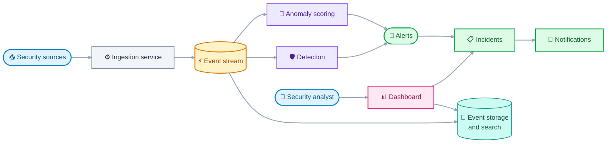

# SecOpsCore Documentation

Central documentation for **SecOpsCore**, a security monitoring platform
(a small SIEM) built to practice and demonstrate modern backend engineering,
DevOps and secure software development.

This repository holds the architecture, the design decisions, the security
documentation and the operational runbooks. Each service lives in its own
repository and keeps only short, service-specific docs that link back here.

## What SecOpsCore does

SecOpsCore ingests security events, stores and indexes them, detects threats
and anomalies, raises alerts and lets an analyst triage them as incidents.

## Technology overview

| Area                         | Technologies                                                                         |
|------------------------------|--------------------------------------------------------------------------------------|
| Backend services             | Java, Spring Boot                                                                    |
| CI/CD and DevSecOps          | GitHub Actions, SAST, dependency and container scanning, DAST                        |
| Containers and orchestration | Docker, Kubernetes (local with kind), Helm, Argo CD                                  |
| Data                         | PostgreSQL (relational), MongoDB (raw events), Elasticsearch (search), Redis (cache) |
| Frontend                     | Angular                                                                              |
| Machine learning             | Python, FastAPI, scikit-learn (anomaly detection)                                    |
| Messaging                    | Apache Kafka (event stream), RabbitMQ (notifications)                                |
| Identity and secrets         | Keycloak (OIDC/OAuth2), HashiCorp Vault                                              |
| Observability                | Micrometer, Prometheus, Grafana, Loki, Tempo, Alloy, OpenTelemetry                   |

The reasoning behind each choice is recorded in the Architecture Decision
Records (ADRs) under `adr/`.

## Repositories

| Repository             | Purpose                                                                | Status      |
|------------------------|------------------------------------------------------------------------|-----------------|
| `anomaly-service`      | ML-based anomaly detection                                             | Planned     |
| `api-gateway`          | Single HTTP entry point: token checks, coarse rate limits, routing     | Planned     |
| `contracts`            | OpenAPI specifications and event schemas                               | Planned     |
| `dashboard`            | Angular web interface                                                  | Planned     |
| `detection-service`    | Rule-based threat detection                                            | Planned     |
| `docs`                 | Central documentation (this repository)                                | Released v0.1.0 |
| `incident-service`     | Alerts and incident management                                         | Planned     |
| `ingestion-service`    | Receives and validates security events                                 | Planned     |
| `notification-service` | Alert delivery                                                         | Planned     |
| `platform`             | Helm charts, Argo CD, observability configuration                      | Planned     |
| `search-service`       | Event storage, search and analytics                                    | Planned     |
| `simulator`            | Generates normal and attack traffic for demos, tests and training data | Planned     |

## Documentation index

### Main documents

| Document                | Description                                | Status  |
|--------------------------|--------------------------------------------|---------|
| `./API_GUIDELINES.md`   | REST conventions                           | Planned |
| `./ARCHITECTURE.md`     | System context, containers and data flow   | Done    |
| `./CHANGELOG.md`        | Release history                            | Done    |
| `./CODING_STANDARDS.md` | Conventions per language                   | Planned |
| `./DATA_MODEL.md`       | Data models per datastore                  | Planned |
| `./DEPLOYMENT.md`       | Kubernetes and GitOps flow                 | Planned |
| `./DEVELOPMENT.md`      | Local development setup                    | Planned |
| `./EVENT_CATALOG.md`    | Kafka topics and event schemas             | Planned |
| `./GIT_WORKFLOW.md`     | Branching, commits, versioning and tagging | Planned |
| `./GLOSSARY.md`        | Domain terms                               | Done    |
| `./INCIDENT_RESPONSE.md` | Incident handling and postmortems          | Planned |
| `./OBSERVABILITY.md`    | Metrics, logs and traces                   | Planned |
| `./README.md`           | This file                                  | Done    |
| `./REQUIREMENTS.md`     | Functional and non-functional requirements | Done    |
| `./ROADMAP.md`          | Phases and milestones                      | Planned |
| `./SLOs.md`             | Service level objectives                   | Planned |
| `./TESTING_STRATEGY.md` | Test pyramid and tooling                   | Planned |

### ADRs

| Document                                                              | Description                                        | Status  |
|-----------------------------------------------------------------------|----------------------------------------------------|---------|
| `adr/0001-record-architecture-decisions.md`                           | Why and how decisions are recorded                 | Done    |
| `adr/0002-use-a-multi-repository-layout.md`                           | Repository structure under one GitHub organization | Done    |
| `adr/0003-use-kafka-for-events-and-rabbitmq-for-notifications.md`     | Choice of message brokers                          | Done    |
| `adr/0004-use-mongodb-for-raw-events-and-elasticsearch-for-search.md` | Choice of datastores for events                    | Done    |
| `adr/0005-use-the-grafana-stack-with-alloy-for-observability.md`      | Choice of observability stack                      | Done    |
| `adr/0006-keep-the-api-gateway-as-the-single-http-entry-point.md`     | The gateway in front of the APIs                   | Done    |
| `adr/0007-keep-the-simulator-in-its-own-repository.md`                | Where the simulator lives                          | Done    |
| `adr/0008-carry-the-original-payload-inside-the-normalized-event.md`  | Original payload carried inside the event          | Done    |

### Other documents

| Document    | Description                                                  | Status  |
|-------------|--------------------------------------------------------------|---------|
| `learning/` | Concept notes on the technologies used                       | Planned |
| `ml/`       | Model card, datasets and evaluation                          | Planned |
| `runbooks/` | Operational runbooks                                         | Planned |
| `security/` | Threat model, secure coding, DevSecOps, secrets, authN/authZ | Planned |

## Conventions

- **Default branch:** `master`.
- **Commits:** [Conventional Commits](https://www.conventionalcommits.org/),
  one commit per incremental change.
- **Versioning:** [Semantic Versioning](https://semver.org/). Each repository
  is versioned and tagged independently.
- **Changelog:** [Keep a Changelog](https://keepachangelog.com/) format.
- **Diagrams:** Mermaid only, no ASCII art. The style rules are defined in
  `CLAUDE.md`.

The full details will live in `GIT_WORKFLOW.md`.

## Project status

The documentation baseline is released as `v0.1.0`: requirements, glossary,
architecture and ADR-0001 to ADR-0008 are accepted. No service code exists yet. The next
sprint covers the roadmap and the event catalog, then the first service.
