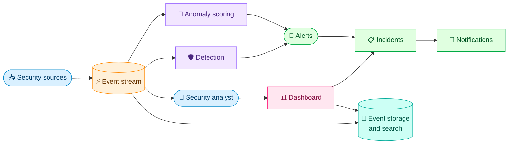

# SecOpsCore Documentation

Central documentation for **SecOpsCore**, a security monitoring platform
(a small SIEM) built to practice and demonstrate modern backend engineering,
DevOps and secure software development.

This repository holds the architecture, the design decisions, the security
documentation and the operational runbooks. Each service lives in its own
repository and keeps only short, service-specific docs that link back here.

## What SecOpsCore does

SecOpsCore ingests security events, stores and indexes them, detects threats
and anomalies, raises alerts and lets an analyst triage them as incidents.

## Technology overview

| Area                         | Technologies                                                                         |
|------------------------------|--------------------------------------------------------------------------------------|
| Backend services             | Java, Spring Boot                                                                    |
| Messaging                    | Apache Kafka (event stream), RabbitMQ (notifications)                                |
| Data                         | PostgreSQL (relational), MongoDB (raw events), Elasticsearch (search), Redis (cache) |
| Machine learning             | Python, FastAPI, scikit-learn (anomaly detection)                                    |
| Frontend                     | Angular                                                                              |
| Identity and secrets         | Keycloak (OIDC/OAuth2), HashiCorp Vault                                              |
| Containers and orchestration | Docker, Kubernetes (local with kind), Helm, Argo CD                                  |
| Observability                | Micrometer, Prometheus, Grafana, Loki, Tempo, Alloy, OpenTelemetry                   |
| CI/CD and DevSecOps          | GitHub Actions, SAST, dependency and container scanning, DAST                        |

The reasoning behind each choice is recorded in the Architecture Decision
Records (ADRs) under `docs/adr/`.

## Repositories

Repositories are created when they are needed, in the order a real project
would follow.

| Repository             | Purpose                                           | Status      |
|------------------------|---------------------------------------------------|-------------|
| `docs`                 | Central documentation (this repository)           | In progress |
| `contracts`            | OpenAPI specifications and event schemas          | Planned     |
| `platform`             | Helm charts, Argo CD, observability configuration | Planned     |
| `ingestion-service`    | Receives and validates security events            | Planned     |
| `detection-service`    | Rule-based threat detection                       | Planned     |
| `incident-service`     | Alerts and incident management                    | Planned     |
| `notification-service` | Alert delivery                                    | Planned     |
| `search-service`       | Event search and analytics                        | Planned     |
| `anomaly-service`      | ML-based anomaly detection                        | Planned     |
| `dashboard`            | Angular web interface                             | Planned     |

## Documentation index

Documents are written one at a time. The table is updated with each one.

| Document                                         | Description                                                  | Status  |
|--------------------------------------------------|--------------------------------------------------------------|---------|
| `README.md`                                      | This file                                                    | Done    |
| `docs/adr/0001-record-architecture-decisions.md` | Why and how decisions are recorded                           | Done    |
| `REQUIREMENTS.md`                                | Functional and non-functional requirements                   | Planned |
| `GLOSSARY.md`                                    | Domain terms                                                 | Planned |
| `ARCHITECTURE.md`                                | System context, containers and data flow                     | Planned |
| `ROADMAP.md`                                     | Phases and milestones                                        | Planned |
| `docs/EVENT_CATALOG.md`                          | Kafka topics and event schemas                               | Planned |
| `docs/DATA_MODEL.md`                             | Data models per datastore                                    | Planned |
| `docs/API_GUIDELINES.md`                         | REST conventions                                             | Planned |
| `docs/DEVELOPMENT.md`                            | Local development setup                                      | Planned |
| `docs/GIT_WORKFLOW.md`                           | Branching, commits, versioning and tagging                   | Planned |
| `docs/CODING_STANDARDS.md`                       | Conventions per language                                     | Planned |
| `docs/TESTING_STRATEGY.md`                       | Test pyramid and tooling                                     | Planned |
| `docs/security/`                                 | Threat model, secure coding, DevSecOps, secrets, authN/authZ | Planned |
| `docs/OBSERVABILITY.md`                          | Metrics, logs and traces                                     | Planned |
| `docs/SLOs.md`                                   | Service level objectives                                     | Planned |
| `docs/DEPLOYMENT.md`                             | Kubernetes and GitOps flow                                   | Planned |
| `docs/runbooks/`                                 | Operational runbooks                                         | Planned |
| `docs/INCIDENT_RESPONSE.md`                      | Incident handling and postmortems                            | Planned |
| `docs/ml/`                                       | Model card, datasets and evaluation                          | Planned |
| `docs/learning/`                                 | Concept notes on the technologies used                       | Planned |

## Conventions

- **Default branch:** `master`.
- **Commits:** [Conventional Commits](https://www.conventionalcommits.org/),
  one commit per incremental change.
- **Versioning:** [Semantic Versioning](https://semver.org/). Each repository
  is versioned and tagged independently.
- **Changelog:** [Keep a Changelog](https://keepachangelog.com/) format.
- **Diagrams:** Mermaid only, no ASCII art. The style rules are defined in
  `docs/GIT_WORKFLOW.md` and `ARCHITECTURE.md` once they exist.

The full details will live in `docs/GIT_WORKFLOW.md`.

## Project status

The project is in its documentation phase. No service code exists yet.
