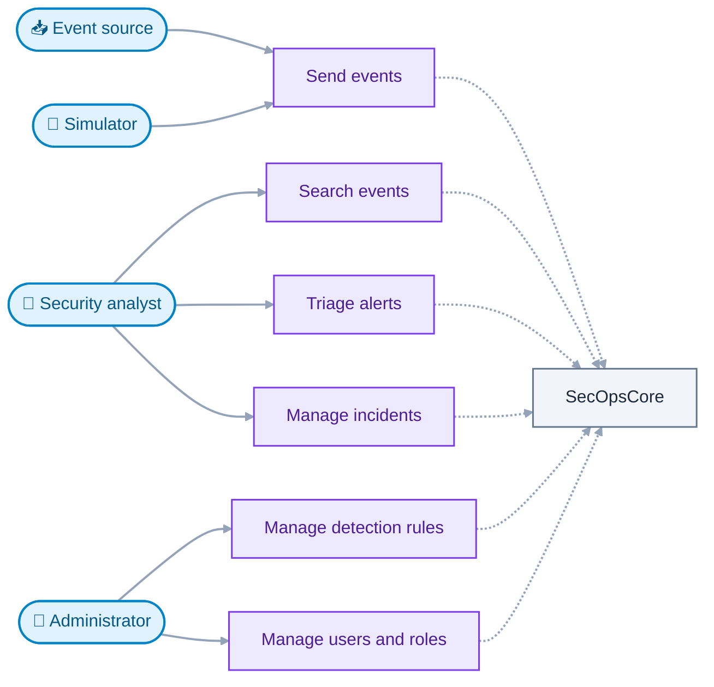

# Requirements

This document defines what SecOpsCore must do (functional requirements) and how
well it must do it (non-functional requirements). It is the reference for
design, testing and scope decisions.

- **Status:** Draft
- **Last updated:** 2026-11-13

## 1. Purpose and scope

SecOpsCore is a small security monitoring platform (a mini SIEM). It collects
security events, stores and indexes them, detects threats with rules and
machine learning, raises alerts and supports analysts in triaging them as
incidents.

The project exists to practice and demonstrate backend engineering, DevOps and
secure development. Requirements are therefore written to be realistic and
testable, but sized for a single developer and a local deployment.

### In scope

- Event ingestion over REST and syslog
- Event storage, retention and search
- Rule-based detection and ML-based anomaly detection
- Alerting and incident management
- Notifications
- A web dashboard for analysts and administrators
- Authentication and role-based authorization
- A traffic and attack simulator for demos and tests
- Observability, CI/CD and DevSecOps practices

### Out of scope

| Item                                       | Reason                                                           |
|--------------------------------------------|------------------------------------------------------------------|
| Multi-tenancy                              | Adds complexity that does not teach new core concepts            |
| Production cloud deployment                | The target is a local Kubernetes cluster                         |
| Host agents that collect logs              | Events are pushed to the platform by the simulator or by clients |
| Automated response (SOAR)                  | The platform detects and informs, it does not act on systems     |
| Compliance certification                   | The project follows good practice but makes no compliance claims |
| Highly available multi-node infrastructure | Single-node infrastructure is enough locally                     |

## 2. How to read this document

### Requirement IDs

Every requirement has a stable ID so it can be referenced from tests, ADRs and
commits.

- Functional: `FR-<AREA>-<NN>`, for example `FR-DET-03`
- Non-functional: `NFR-<CATEGORY>-<NN>`, for example `NFR-SEC-02`

IDs are never reused. A removed requirement is marked as withdrawn, not
deleted.

### Priority (MoSCoW)

| Priority   | Meaning                                                   |
|------------|-----------------------------------------------------------|
| **Must**   | Required for the project to be considered working         |
| **Should** | Important, included unless time or complexity prevents it |
| **Could**  | Desirable extra, included if everything else is done      |

"Won't" items are listed under *Out of scope*.

### Quality criteria

A good requirement is specific, testable and free of implementation detail
(the *how* belongs in the architecture). Numeric targets in this document are
**initial targets**, to be validated with load tests and revised through the
normal change process.

## 3. Actors

| Actor                | Description                                                    |
|----------------------|----------------------------------------------------------------|
| **Security analyst** | Reviews events and alerts, investigates and resolves incidents |
| **Administrator**    | Manages users, detection rules and system settings             |
| **Event source**     | An external system that sends security events to the platform  |
| **Simulator**        | A tool that produces normal traffic and attack scenarios       |

## 4. Functional requirements

### 4.1 Event ingestion (ING)

| ID        | Requirement                                                                                                       | Priority |
|-----------|-------------------------------------------------------------------------------------------------------------------|----------|
| FR-ING-01 | The system shall accept security events as JSON over a REST API.                                                  | Must     |
| FR-ING-02 | The system shall accept security events over syslog (RFC 5424).                                                   | Should   |
| FR-ING-03 | The system shall validate each event against the event schema and reject invalid events with a descriptive error. | Must     |
| FR-ING-04 | The system shall authenticate each event source with a per-source credential and reject unauthenticated requests. | Must     |
| FR-ING-05 | The system shall normalize accepted events into a common event format before further processing.                  | Must     |
| FR-ING-06 | The system shall rate-limit each event source and respond with a clear error when the limit is exceeded.          | Should   |
| FR-ING-07 | The system shall accept events in batches in a single request.                                                    | Should   |

### 4.2 Storage and search (STO)

| ID        | Requirement                                                                               | Priority |
|-----------|-------------------------------------------------------------------------------------------|----------|
| FR-STO-01 | The system shall persist every accepted event in its original form.                       | Must     |
| FR-STO-02 | The system shall delete events after a configurable retention period.                     | Should   |
| FR-STO-03 | The system shall support full-text and field-based search over events.                    | Must     |
| FR-STO-04 | The system shall support filtering by time range, source and event type, with pagination. | Must     |
| FR-STO-05 | The system shall provide aggregations, such as event counts by type over time.            | Should   |

### 4.3 Rule-based detection (DET)

| ID        | Requirement                                                                                                  | Priority |
|-----------|--------------------------------------------------------------------------------------------------------------|----------|
| FR-DET-01 | The system shall evaluate detection rules against the event stream continuously.                             | Must     |
| FR-DET-02 | The system shall provide built-in rules for brute-force login attempts, impossible travel and port scanning. | Must     |
| FR-DET-03 | The system shall support rules that count or correlate events over a time window.                            | Must     |
| FR-DET-04 | An administrator shall be able to enable, disable and tune rule parameters without redeploying the system.   | Should   |
| FR-DET-05 | Every alert produced by a rule shall reference the events that triggered it.                                 | Must     |
| FR-DET-06 | The system shall allow new rules to be defined in a documented rule format.                                  | Could    |

### 4.4 Anomaly detection (ANO)

| ID        | Requirement                                                                                                              | Priority |
|-----------|--------------------------------------------------------------------------------------------------------------------------|----------|
| FR-ANO-01 | The system shall assign an anomaly score to behaviour aggregated per entity (user or source address) over a time window. | Must     |
| FR-ANO-02 | The system shall raise an alert when an anomaly score exceeds a configurable threshold.                                  | Must     |
| FR-ANO-03 | The system shall record which model version produced each score.                                                         | Should   |
| FR-ANO-04 | The system shall allow a model to be retrained offline from stored events and deployed as a new version.                 | Could    |

### 4.5 Alerts and incidents (INC)

| ID        | Requirement                                                                                                       | Priority |
|-----------|-------------------------------------------------------------------------------------------------------------------|----------|
| FR-INC-01 | The system shall persist every alert with its severity, source (rule or model) and related events.                | Must     |
| FR-INC-02 | The system shall group related alerts into a single incident and avoid duplicate incidents for the same activity. | Must     |
| FR-INC-03 | An incident shall have a lifecycle: open, investigating, resolved or false positive.                              | Must     |
| FR-INC-04 | An analyst shall be able to assign an incident and add comments.                                                  | Should   |
| FR-INC-05 | The system shall keep an audit trail of every change to an incident, including who made it and when.              | Must     |
| FR-INC-06 | The system shall assign a severity to each incident based on its alerts.                                          | Should   |

### 4.6 Notifications (NOT)

| ID        | Requirement                                                                                                                            | Priority |
|-----------|----------------------------------------------------------------------------------------------------------------------------------------|----------|
| FR-NOT-01 | The system shall notify through at least one channel (email or webhook) when an incident at or above a configured severity is created. | Must     |
| FR-NOT-02 | The system shall retry failed notifications with increasing delay and move permanently failed ones to a review queue.                  | Should   |
| FR-NOT-03 | An administrator shall be able to configure notification channels and severity thresholds.                                             | Could    |

### 4.7 Dashboard (DSH)

| ID        | Requirement                                                                             | Priority |
|-----------|-----------------------------------------------------------------------------------------|----------|
| FR-DSH-01 | The dashboard shall show a live feed of incoming events.                                | Should   |
| FR-DSH-02 | The dashboard shall let analysts review and triage alerts.                              | Must     |
| FR-DSH-03 | The dashboard shall show an incident with its alerts, events and history on a timeline. | Must     |
| FR-DSH-04 | The dashboard shall provide event search using the search requirements above.           | Must     |
| FR-DSH-05 | The dashboard shall show summary charts, such as events and alerts over time.           | Should   |
| FR-DSH-06 | The dashboard shall let administrators manage detection rules.                          | Should   |

### 4.8 Identity and access (IAM)

| ID        | Requirement                                                                                         | Priority |
|-----------|-----------------------------------------------------------------------------------------------------|----------|
| FR-IAM-01 | Users shall sign in through a standard OpenID Connect flow.                                         | Must     |
| FR-IAM-02 | The system shall support the roles analyst and administrator.                                       | Must     |
| FR-IAM-03 | Every API shall enforce role-based authorization on the server side.                                | Must     |
| FR-IAM-04 | User accounts and roles shall be managed in the identity provider, not in the application services. | Should   |

### 4.9 Simulator (SIM)

| ID        | Requirement                                                                                                       | Priority |
|-----------|-------------------------------------------------------------------------------------------------------------------|----------|
| FR-SIM-01 | The simulator shall generate realistic normal event traffic at a configurable rate.                               | Should   |
| FR-SIM-02 | The simulator shall inject labelled attack scenarios (for example brute force, port scan) into the traffic.       | Should   |
| FR-SIM-03 | Labelled simulator output shall be usable as test data and as training and evaluation data for the anomaly model. | Could    |

## 5. Non-functional requirements

### 5.1 Performance

| ID          | Requirement                                                                                                            | Priority |
|-------------|------------------------------------------------------------------------------------------------------------------------|----------|
| NFR-PERF-01 | The platform shall sustain at least 1,000 events per second on the reference local environment.                        | Should   |
| NFR-PERF-02 | The 95th percentile time from event acceptance to alert creation shall be under 2 seconds at the sustained load above. | Should   |
| NFR-PERF-03 | Event searches over the last 24 hours shall return in under 1 second at the 95th percentile.                           | Should   |

### 5.2 Reliability and data integrity

| ID         | Requirement                                                                                         | Priority |
|------------|-----------------------------------------------------------------------------------------------------|----------|
| NFR-REL-01 | An accepted event shall not be lost if a single service restarts.                                   | Must     |
| NFR-REL-02 | Event processing shall tolerate duplicate delivery without producing duplicate alerts or incidents. | Must     |
| NFR-REL-03 | A failure in one downstream service shall not stop event ingestion.                                 | Must     |
| NFR-REL-04 | Services shall handle unavailable dependencies with timeouts, retries and circuit breakers.         | Should   |

### 5.3 Scalability

| ID         | Requirement                                                                                    | Priority |
|------------|------------------------------------------------------------------------------------------------|----------|
| NFR-SCA-01 | Stateless services shall be horizontally scalable by running more instances.                   | Must     |
| NFR-SCA-02 | Event processing shall be parallelizable across partitions without losing per-entity ordering. | Should   |

### 5.4 Security

| ID         | Requirement                                                                                                            | Priority |
|------------|------------------------------------------------------------------------------------------------------------------------|----------|
| NFR-SEC-01 | All external traffic shall use TLS.                                                                                    | Must     |
| NFR-SEC-02 | No secret (password, key, token) shall be stored in source control or container images.                                | Must     |
| NFR-SEC-03 | All input shall be validated, and the system shall protect against the OWASP Top 10 categories relevant to its design. | Must     |
| NFR-SEC-04 | Services shall run with least privilege, as non-root containers with restricted network access.                        | Should   |
| NFR-SEC-05 | Service-to-service communication shall be authenticated.                                                               | Should   |
| NFR-SEC-06 | The build pipeline shall scan code, dependencies and container images and fail on high-severity findings.              | Must     |
| NFR-SEC-07 | Security-relevant actions shall be written to an audit log that cannot be modified through the application.            | Should   |
| NFR-SEC-08 | Sensitive fields in events (for example credentials in payloads) shall be masked before storage and display.           | Could    |

### 5.5 Observability

| ID         | Requirement                                                                      | Priority |
|------------|----------------------------------------------------------------------------------|----------|
| NFR-OBS-01 | Every service shall expose health and metrics endpoints.                         | Must     |
| NFR-OBS-02 | Every service shall write structured logs that include a trace identifier.       | Must     |
| NFR-OBS-03 | Requests and event processing shall be traceable across services.                | Should   |
| NFR-OBS-04 | The platform shall define service level objectives and alert on their violation. | Should   |

### 5.6 Maintainability and quality

| ID         | Requirement                                                                                              | Priority |
|------------|----------------------------------------------------------------------------------------------------------|----------|
| NFR-MNT-01 | Each service shall be built, tested, versioned and deployable independently.                             | Must     |
| NFR-MNT-02 | Automated tests shall cover unit, integration and contract levels, with a coverage gate on domain logic. | Must     |
| NFR-MNT-03 | Every significant architectural decision shall be recorded as an ADR.                                    | Must     |
| NFR-MNT-04 | Every change shall follow the commit, versioning and changelog conventions.                              | Must     |
| NFR-MNT-05 | Public interfaces shall be documented with machine-readable specifications.                              | Must     |

### 5.7 Portability and operability

| ID         | Requirement                                                                                  | Priority |
|------------|----------------------------------------------------------------------------------------------|----------|
| NFR-OPS-01 | The full platform shall run locally on a developer machine using a local Kubernetes cluster. | Must     |
| NFR-OPS-02 | A reduced setup using Docker Compose shall be available for day-to-day development.          | Should   |
| NFR-OPS-03 | Deployment shall be declarative and reproducible from the platform repository.               | Must     |
| NFR-OPS-04 | Each likely failure mode shall have a runbook.                                               | Should   |

### 5.8 Usability

| ID         | Requirement                                                                                                             | Priority |
|------------|-------------------------------------------------------------------------------------------------------------------------|----------|
| NFR-USA-01 | The dashboard shall support common accessibility practices (keyboard navigation, sufficient contrast, semantic markup). | Could    |

## 6. Constraints and assumptions

### Constraints

- The project is built and operated by one person.
- It runs on local infrastructure and uses free or open-source tools only.
- The technology choices listed in the README are fixed starting points. They
  can be revised only through an ADR.
- Each repository is versioned independently.

### Assumptions

- Events are pushed to the platform. The platform does not poll sources.
- Event volume is within the limits of a single developer machine.
- Simulated data is an acceptable substitute for real traffic.
- Time is not a constraint, so quality and learning take priority over delivery
  speed.

## 7. Traceability

Requirements are traced forward through the project:

- **Design:** `ARCHITECTURE.md` and the ADRs reference the requirement IDs they
  satisfy.
- **Tests:** test names and descriptions reference the IDs they verify.
- **Commits and changelogs:** feature commits mention the IDs they implement.

## 8. Change process

Requirements change through a normal commit. A change that adds, removes or
re-prioritizes a requirement is recorded in a commit message that names the
affected IDs. A change that reverses a significant decision also requires an
ADR.
